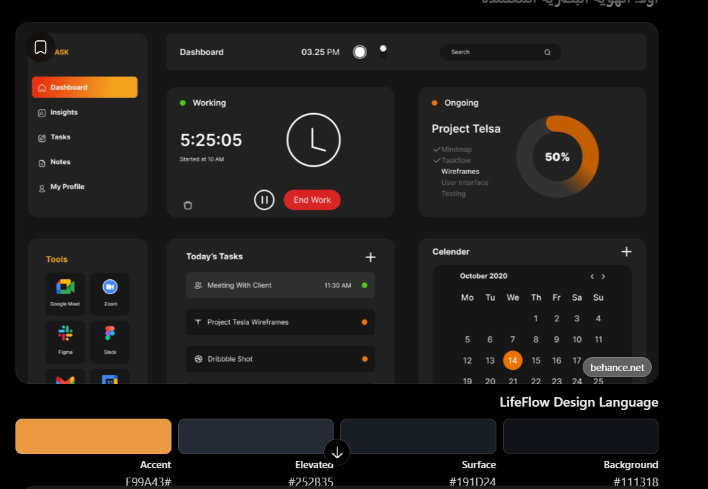
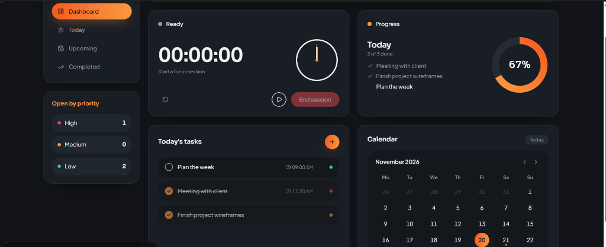
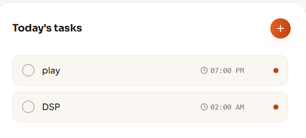
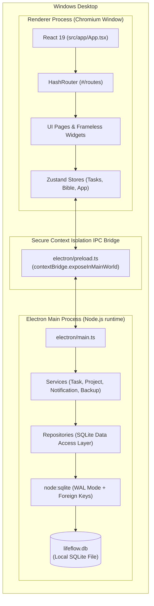

<div align="center">

# LifeFlow

**A Calm, Offline-First Personal Productivity & Life Organizer for Windows**

*Designed for focused individuals seeking clarity, calm organization, and complete data privacy.*

[](https://github.com/GiovanyGeorge/to_do_list)
[](https://www.electronjs.org/)
[](https://react.dev/)
[](https://www.typescriptlang.org/)
[-003B57?style=flat-square&logo=sqlite)](https://sqlite.org/)
[](https://tailwindcss.com/)
[](LICENSE)
[](tests)

<br/>

<p align="center">
  <a href="#overview"><b>Overview</b></a> •
  <a href="#features"><b>Features</b></a> •
  <a href="#screenshots"><b>Screenshots</b></a> •
  <a href="#technology-stack"><b>Tech Stack</b></a> •
  <a href="#architecture"><b>Architecture</b></a> •
  <a href="#installation--setup"><b>Installation</b></a> •
  <a href="#daily-bible-verse"><b>Daily Bible Verse</b></a> •
  <a href="#documentation"><b>Docs</b></a>
</p>

</div>

---

## Overview

**LifeFlow** is a personal desktop life organizer tailored for Windows. It provides a peaceful, unified workspace combining task management, subtasks, project workflows, calendar scheduling, habits tracking, long-term goals, markdown notes, productivity analytics, lightweight desktop widgets, and an offline Daily Bible Verse feature.

### Design Philosophy: Paper-Like Warm Cream
LifeFlow departs from harsh neon dark modes and stark corporate interfaces. Instead, it utilizes a warm, paper-inspired visual aesthetic:
- **Warm Cream Canvas (`#FAF7F2`)**: Soft on the eyes for extended focus periods.
- **Pure Paper Surfaces (`#FFFFFF`)**: Subtle layered elevations and delicate hairline borders.
- **Terracotta Accent (`#C2410C`)**: An organic, calming primary action color.
- **Editorial Typography**: Styled using *Plus Jakarta Sans*, *Sora*, and *Cairo* (for Arabic script).

### Core Principles
- **Offline-First & Local-Only**: 100% of your data remains on your physical PC inside a local SQLite database (`.lifeflow-data/lifeflow.db`). No cloud sync, no tracking, and no external backends.
- **Single-User Sovereignty**: Designed specifically for individual life organization without team clutter, mandatory accounts, or online logins.
- **Bilingual & Bidirectional**: Native English (LTR) and Arabic (RTL) support with instantaneous layout flipping.

---

## Features

LifeFlow is organized into clean functional modules, with all core features verified by an automated test suite.

| Module | Status | Description |
| :--- | :---: | :--- |
| **Task Management** |  | Create, edit, toggle, soft-delete, and archive tasks with priorities (`urgent`, `high`, `medium`, `low`), due dates, start times, and recurrence rules. |
| **Smart Daily Planner & Carry-over** |  | Intelligent suggestions for overdue tasks, carried-over unfinished items, and high-priority backlog; unfinished tasks never disappear silently. |
| **Subtasks & Progress Engine** |  | Multi-subtask breakdown with inline title editing, reordering, partial percentage progress (e.g. 3/5 = 60%), and aggregation into project rates. |
| **Categories System** |  | Color-coded and icon-coded classification for work, study, personal, health, and custom areas. |
| **Projects Management** |  | Multi-task project organization, instant task creation inside project details, and weighted subtask progress roll-up. |
| **Goals & Dynamic Milestones** |  | Long-term aspiration tracking with card-level milestone creation, inline editing, reordering, project/task linking, and Next Milestone highlight. |
| **Focus Stopwatch (Zero Drift)** |  | Persistent, timestamp-synchronized open-ended stopwatch starting at 00:00:00, resilient to Chromium background throttling, shared with desktop widget. |
| **Calendar & Day Planner** |  | Single-source-of-truth date generation (`YYYY-MM-DD`), monthly overview, and daily planning boards. |
| **Habits & Streaks** |  | Daily and weekly habit tracking with streak counters, completion logs, and pre-built habit libraries. |
| **Notes & Scratchpad** |  | Fast local note taking with category linking and instant full-text search. |
| **Desktop Floating Widgets** |  | Standalone frameless micro-windows (Today's Tasks, Quick Add, Habits, Focus Stopwatch, Daily Schedule) with Always-on-Top pin toggle. |
| **Background Lifecycle & Tray** |  | Minimizes to system tray on close, keeping widgets accessible in the background until explicit exit; supports Start with Windows. |
| **Daily Bible Verse** |  | Public-domain Smith & Van Dyke translation (31,104 verses), stable daily rotation, Psalm heading separation, and local Favorites. |
| **Backup & Data Export** |  | Atomic SQLite hot backups (`VACUUM INTO`), pre-restore checkpoints, and JSON/CSV data export. |
| **Bilingual Localization** |  | Full English and Arabic translations with automatic layout switching (`dir="ltr"` / `dir="rtl"`). |

---

## Screenshots

<div align="center">

### Main Dashboard & Task Workspace (English LTR)

*LifeFlow main application window featuring the paper-like design system, navigation sidebar, quick task entry, and daily agenda.*

<br/>

### Arabic Interface (Full RTL Experience)

*Native Arabic typography using the Cairo font, inverted layouts, and bidirectional controls.*

<br/>

### Today's Tasks Drag-and-Drop & Progress View

*Interactive drag-and-drop task ordering with nested subtask progress and time badges.*

</div>

---

## Technology Stack

LifeFlow is built entirely with modern, verified technologies without bloated third-party framework layers:

```
┌─────────────────────────────────────────────────────────────┐
│                       LifeFlow Stack                        │
├────────────────────────────────┬────────────────────────────┤
│ Runtime & Packaging            │ Electron 35.7.5            │
│ Frontend Framework             │ React 19.0.0               │
│ Programming Language           │ TypeScript 5.7.3           │
│ Bundler & Build Tool           │ Vite 6.2.1                 │
│ Database Engine                │ SQLite (via node:sqlite)   │
│ Client State Management        │ Zustand 5.0.3              │
│ Routing Architecture           │ React Router (HashRouter)  │
│ Styling & Design Tokens        │ Tailwind CSS 3.4.17        │
│ Motion & Animations            │ Motion 14.14.0 (Framer)    │
│ Iconography                    │ Lucide React 1.16.0        │
│ Internationalization           │ i18next 24.2 & react-i18next│
│ Schema Validation              │ Zod 3.24.2                 │
│ Automated Testing              │ Vitest 3.0.8 (45 tests)    │
└────────────────────────────────┴────────────────────────────┘
```

---

## Architecture

LifeFlow employs an asynchronous multi-process architecture based on Electron's process model.



### Process Isolation & Security
- **Strict Sandbox**: `nodeIntegration: false` and `contextIsolation: true` are enforced on all windows.
- **Typed IPC Contract**: The renderer invokes strictly declared asynchronous channels (`ipcRenderer.invoke`) through typed declarations in [shared/types/ipc.ts](file:///shared/types/ipc.ts).
- **Embedded Database Driver**: Uses Node.js's built-in `node:sqlite` (`DatabaseSync`) wrapped in a clean, typed repository layer in [database/sqlite.ts](file:///database/sqlite.ts), removing dependencies on vulnerable native recompilations.

For a detailed technical walkthrough, see [ARCHITECTURE.md](docs/ARCHITECTURE.md).

---

## Project Structure

```
lifeFlow/
├── database/                    # SQLite engine, migrations & repositories
│   ├── migrations/              # SQL schema migration scripts (001 - 005)
│   ├── repositories/            # Typed Data Access Objects (Tasks, Habits, Bible...)
│   ├── connection.ts            # Database initialization, WAL pragma & paths
│   ├── migrator.ts              # Atomic transaction migration runner
│   ├── psalmsSplit.json         # Precise Psalm headings split dataset
│   ├── sqlite.ts                # node:sqlite compatibility layer
│   └── svd.sqlite               # Public-domain Smith & Van Dyke 1865 Bible
├── docs/                        # Architecture, screenshots & guides
│   ├── screenshots/             # Application visual assets
│   ├── ARCHITECTURE.md          # Technical architecture documentation
│   └── DEVELOPMENT.md           # Developer workflow & setup guide
├── electron/                    # Electron Main Process & Native integration
│   ├── ipc/                     # IPC handler registration modules
│   ├── services/                # Business logic (Notification, Task, Backup...)
│   ├── windows/                 # Detached desktop widget window manager
│   ├── main.ts                  # Main process entry point
│   └── preload.ts               # ContextBridge secure API exposure
├── shared/                      # Shared types & constants across processes
│   ├── constants/               # System & design constants
│   └── types/                   # Database records and IPC interface definitions
├── src/                         # React 19 Frontend application
│   ├── app/                     # App component & HashRouter configuration
│   ├── components/              # UI components (Layout, Bible, Tasks, Modals)
│   ├── hooks/                   # Custom React hooks (Motion, Sounds, Windows)
│   ├── locales/                 # i18n dictionaries (ar.json, en.json)
│   ├── pages/                   # Application views (Dashboard, MyDay, Calendar...)
│   ├── store/                   # Zustand global state slices
│   └── styles/                  # Tailwind CSS tokens & globals
├── tests/                       # Vitest automated test suites (12 suites, 45 tests)
├── electron-builder.json        # Windows NSIS & unpacked packaging specs
├── package.json                 # Dependencies and execution scripts
├── tailwind.config.js           # Warm cream theme design tokens
└── vite.config.ts               # Vite bundler and electron integration plugins
```

---

## Installation & Setup

### Prerequisites
- **Operating System**: Windows 10 or Windows 11 (64-bit).
- **Node.js**: Node.js 22.x LTS or higher (required for `node:sqlite`).
- **Package Manager**: `pnpm` (recommended) or `npm`.

### 1. Clone the Repository
```bash
git clone https://github.com/GiovanyGeorge/to_do_list.git
cd to_do_list
```

### 2. Install Dependencies
```bash
pnpm install
```

### 3. Run in Development Mode
Launches Vite in development mode with hot-module-replacement and attaches Electron:
```bash
pnpm run dev
```

### 4. Run the Test Suite
Executes all 45 automated test suites covering repositories, migrations, IPC contracts, and Bible logic:
```bash
pnpm test
```

### 5. Build for Production
Compiles TypeScript, packages frontend assets with Vite, and builds both the Windows NSIS Installer and the unpacked standalone application:
```bash
pnpm run build
```

Generated outputs will be located in the `release/` directory:
- **Windows Installer (`.exe`)**: `release/LifeFlow Setup 1.0.0.exe`
- **Portable Unpacked Directory**: `release/win-unpacked/LifeFlow.exe`

For detailed setup instructions, troubleshooting, and guidelines, see [DEVELOPMENT.md](docs/DEVELOPMENT.md).

---

## Database

LifeFlow uses local **SQLite** configured for desktop durability:
- **Storage Location**: Stored safely in `%APPDATA%/lifeflow/data/lifeflow.db` in production (or `.lifeflow-data/lifeflow.db` during development).
- **Performance & Durability**: Configured with `PRAGMA journal_mode = WAL;` (Write-Ahead Logging) and `PRAGMA foreign_keys = ON;`.
- **Migration Engine**: Migrations in [database/migrations/](file:///database/migrations/) are applied sequentially within atomic SQLite transactions recorded in the `_migrations` tracking table.
- **Zero Cloud Footprint**: Data is never shared or synchronized externally.

---

## Daily Bible Verse

LifeFlow includes a complete, independent **Daily Bible Verse** feature:

- **Translation**: Uses the historical **Smith & Van Dyke Arabic Translation (ترجمة فان دايك 1865)**.
- **Verified Public Domain Dataset**: Includes all 66 canonical books (39 Old Testament, 27 New Testament) comprising 31,104 verses bundled in [database/svd.sqlite](file:///database/svd.sqlite).
- **Deterministic Selection**: Displays one inspiring verse per calendar day based on a date-hash algorithm that avoids repeating verses shown within the last 180 days.
- **Psalm Heading Separation**: Hebrew superscriptions (e.g. *مزمور حمد* or *مزمور لداود*) are separated into a dedicated `heading` field across all 116 non-orphan Psalms, guaranteeing that canonical verse text is never altered or concatenated.
- **Favorites System**: Bookmark verses offline, search through saved items, and copy formatted references with one click.
- **No Notifications**: In adherence to product privacy decisions, the Bible feature does not issue push notifications.

---

## Data Privacy

- **100% Offline**: LifeFlow contains zero analytics trackers, telemetry collectors, external API requests, or remote backends.
- **Local Isolation**: Your database never leaves your personal machine.
- **Hot Backups**: Export your database or make one-click local backups at any time via Settings.

---

## Documentation

- **[Technical Architecture Guide (ARCHITECTURE.md)](docs/ARCHITECTURE.md)**: Deep dive into Electron processes, IPC channels, SQLite database access, and window orchestration.
- **[Development & Contribution Guide (DEVELOPMENT.md)](docs/DEVELOPMENT.md)**: How to set up your environment, write tests, add migrations, and package releases.

---

## Roadmap

- [x] Complete Paper-Like Warm Cream design system across all pages.
- [x] Interactive drag-and-drop task reordering in Today's tasks.
- [x] Subtasks engine with completion progress tracking.
- [x] Category classification system with color chips.
- [x] Detachable floating desktop micro-widgets (Quick Add, Today's Tasks, Pomodoro, Habits).
- [x] Complete Daily Bible Verse feature with Psalm superscription separation.
- [x] Production packaging (NSIS installer & unpacked portable builds).
- [ ] Keyboard navigation shortcuts across the entire task board (`Ctrl+K` command palette).
- [ ] Customizable theme accents (Sage Green, Classic Slate).
- [ ] Encrypted database backup option.

---

## License & Credits

- **Application License**: Distributed under the [MIT License](LICENSE).
- **Bible Translation**: Smith & Van Dyke Arabic Translation (1865) is in the **Public Domain**.
- **Icons**: [Lucide Icons](https://lucide.dev/) (ISC License).
- **Fonts**: [Plus Jakarta Sans](https://fonts.google.com/specimen/Plus+Jakarta+Sans), [Sora](https://fonts.google.com/specimen/Sora), and [Cairo](https://fonts.google.com/specimen/Cairo) (SIL Open Font License).

<div align="center">
<sub>Built with care for calm, private, and focused personal organization.</sub>
</div>
