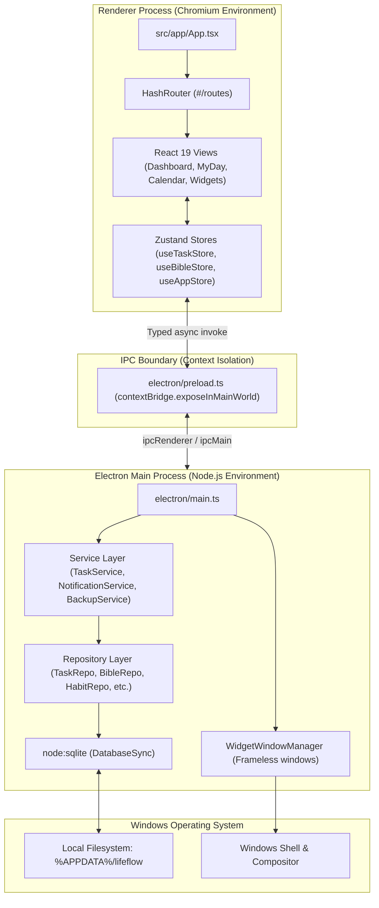
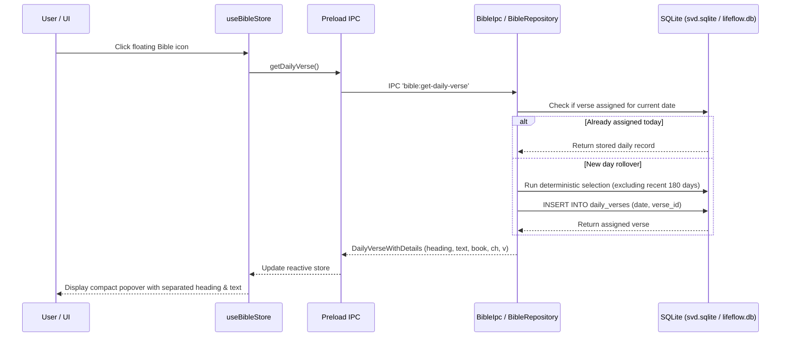

# LifeFlow Technical Architecture

This document describes the architectural design, process separation, data flows, and security model of LifeFlow.

---

## 1. Process Separation Model

LifeFlow adheres to Electron's security-first multi-process architecture, decoupling desktop OS integration from user interface rendering.

### Main Process Responsibilities
- **Application Lifecycle**: Managing window creation, hardware acceleration settings, and graceful database shutdowns.
- **Data Persistence**: Sole custodian of the local SQLite database connection.
- **Native OS Integration**: Local notifications, audio playback dispatch, file backups (`VACUUM INTO`), and window state persistence.
- **Widget Window Management**: Orchestrating detached micro-windows that float over the Windows desktop.

### Preload Script (`electron/preload.ts`)
The preload layer operates as a secure intermediary using Electron's `contextBridge`:
- Exposes a typed `window.electronAPI` interface into the renderer's global scope.
- Enforces channel whitelisting so the renderer can only invoke sanctioned operations.
- Forbids direct Node.js or filesystem access from the renderer.

### Renderer Process (`src/`)
Built with React 19 and TypeScript:
- **Routing**: Employs `HashRouter` to maintain complete independence from filesystem paths when loading via `file://`.
- **State Management**: Zustand slices manage in-memory collections of tasks, categories, bible verses, and UI preferences.
- **Styling**: Tailwind CSS configured with a Paper-Like Warm Cream design system.

---

## 2. Local Database Layer

LifeFlow runs completely offline using SQLite.

### Database Engine & Driver
- Uses Node.js's built-in `node:sqlite` (`DatabaseSync`), wrapped in a compatibility layer at `database/sqlite.ts`.
- **WAL Mode**: Initialized with `PRAGMA journal_mode = WAL;` to support non-blocking concurrent reads during background writes.
- **Foreign Key Enforcement**: Configured with `PRAGMA foreign_keys = ON;` to ensure referential integrity.

### Schema Migrations (`database/migrator.ts`)
Migrations reside as individual SQL scripts in `database/migrations/`:
- `001_initial_schema.sql`: Tasks, subtasks, projects, tags, dependencies, and day plans.
- `002_notifications.sql`: Reminders and notification logs.
- `003_habits_goals_notes.sql`: Habits, habit completion logs, long-term goals, and markdown notes.
- `004_categories.sql`: Task categories and foreign key linking.
- `005_bible_verse.sql`: Canonical Bible books, verses table (with separated headings), daily history, and favorites.

Migrations execute sequentially within an atomic SQLite transaction recorded in `_migrations`.

---

## 3. Daily Bible Verse Data Pipeline

The Daily Bible Verse system relies on a local dataset of the historical Smith & Van Dyke translation (1865):

### Superscription Separation
To ensure canonical accuracy:
- The raw source text for Psalms originally merged Hebrew headings into Verse 1.
- During database initialization, `migrator.ts` maps all 116 non-orphan Psalms via `database/psalmsSplit.json`.
- The heading (e.g. *مزمور حمد*) is extracted into `heading TEXT`, leaving the pure verse text (e.g. *اهتفي للرب يا كل الأرض*) intact.

---

## 4. Desktop Widgets Architecture

LifeFlow supports independent floating desktop widgets:
1. **Today's Tasks Widget**: Micro view for tracking daily tasks without the main application window.
2. **Quick Add Widget**: Rapid task creation dialog.
3. **Pomodoro Timer**: Minimalist countdown widget.
4. **Habit Tracker**: Daily streak logger.

Each widget is instantiated via `WidgetWindowManager` with `frame: false`, `alwaysOnTop: true`, and custom coordinates saved across sessions in local settings.

---

## 5. Security Posture

- **Context Isolation**: Always enabled (`contextIsolation: true`).
- **No Node Integration in DOM**: `nodeIntegration: false`.
- **Zero Remote Endpoints**: No telemetry, no third-party CDNs, and no external tracking scripts.
- **Atomic Local Backups**: Uses SQLite's `VACUUM INTO` engine to snapshot databases safely without corrupting active WAL journals.
